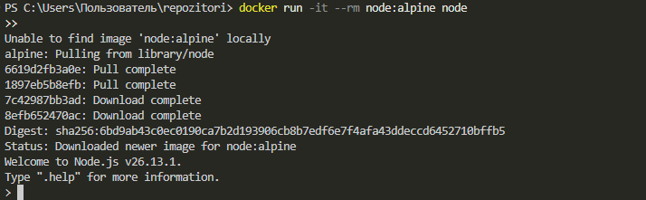
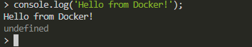
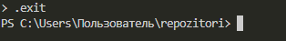
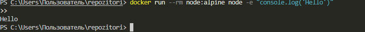

## Node.js для JavaScript

> **Это задание лучше выполнять в WSL или в другом полноценном Linux!**

Выполните все этапы работы с проектом по примеру с [Nginx](/content/Docker/ImageLibrary/Nginx.md)

- > Никогда в разработке не используйте русские имена файлов и каталогов!
- > Никогда в разработке не используйте пробелы и спец.символы в именах файлов и каталогов!
- > Перед созданием проекта убедитесь, что порт 8084 не занят другим приложением!
- > Создание проекта лучше начать с "чистого листа", предварительно остановив и удалив все другие контейнеры и образы!

Запустить **Node.js REPL**
```shell
docker run -it --rm node:alpine node
```



И запустить скрипт
```shell
console.log('Hello from Docker!');
```



Для выхода из консоли
```shell
.exit
```



или
```shell
docker run --rm node:alpine node -e "console.log('Hello')"
```



> Если вы обнаружили ошибку в этом тексте - сообщите пожалуйста автору!