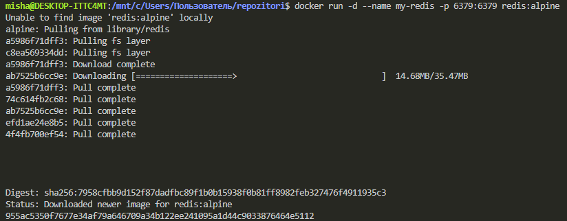
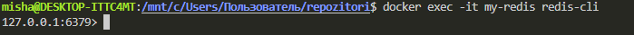
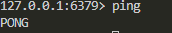
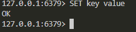
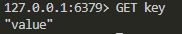

## База данных Redis

> **Это задание лучше выполнять в WSL или в другом полноценном Linux!**

- > Никогда в разработке не используйте русские имена файлов и каталогов!
- > Никогда в разработке не используйте пробелы и спец.символы в именах файлов и каталогов!
- > Перед созданием проекта убедитесь, что порт 8084 не занят другим приложением!
- > Создание проекта лучше начать с "чистого листа", предварительно остановив и удалив все другие контейнеры и образы!

Запуск **Redis**
```shell
docker run -d --name my-redis -p 6379:6379 redis:alpine
```

Подключиться к **Redis CLI**
```shell
docker exec -it my-redis redis-cli
```

Внутри Redis: ping → PONG, SET key value, GET key - ?



> Если вы обнаружили ошибку в этом тексте - сообщите пожалуйста автору!